# Test evidence

Screenshots are in the [evidence](evidence/) folder.

## Results summary

| Test | Issue | Path observed | Ledger status | Route-log row | Verdict |
| --- | --- | --- | --- | --- | --- |
| 1 | #6 Bug: blank screen after logout | execution list only | recorded | yes (id 7) | Partial: path not screenshotted |
| 2 | #7 Feature request: export task list to CSV | Set feature route | recorded | yes (id 8) | Routed correctly |
| 3 | #8 Help: change the public webhook address | Set help route | recorded | yes (id 9) | Routed correctly |
| 4 | #10 Documentation: clarify local setup | Set other route | recorded | yes (id 10) | Routed correctly |
| Extra | #11 Bug: blank screen after logout (second issue) | Set bug route | recorded | yes (id 11) | Routed correctly |
| Failure | #12 Documentation: intentional route-log failure test | Set other route, then Update route-log recorded | recorded (expected failed) | yes, id 12 (expected none) | **Fail** |
| Redelivery | Test 1 delivery | not captured | n/a | n/a | Not demonstrated |
| Gate | Edit of Test 4 body | not captured | n/a | n/a | Not demonstrated |

In the stored rows `category` is Null in the ledger, and `category` and `route_name` are Null in the route log, even though the execution graph shows the correct Set route node ran. The route was therefore proven by the execution path, not by the stored value.

## Test 1: bug (issue #6)

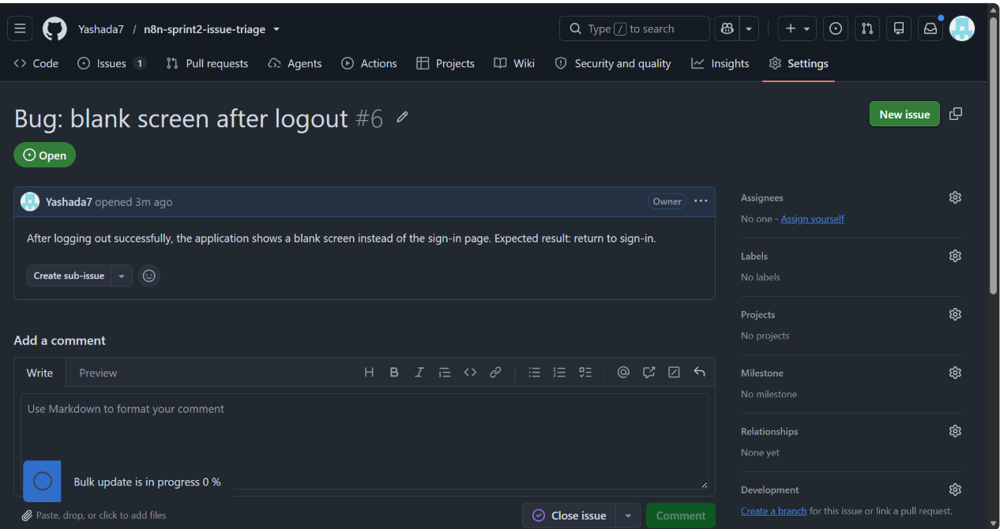
Figure 1. Issue #6 with the exact Test 1 title and body.

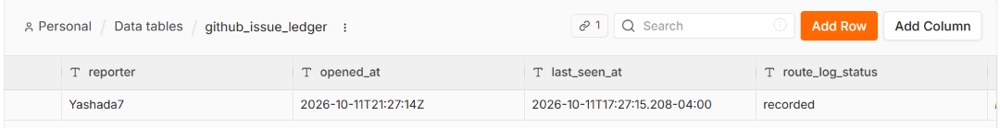
Figure 2. Ledger row for #6, `route_log_status = recorded`.

## Test 2: feature (issue #7)

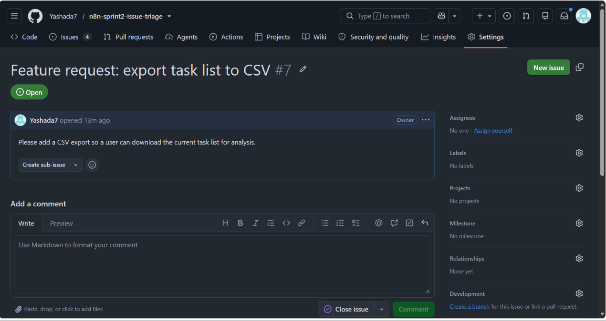
Figure 3. Issue #7.

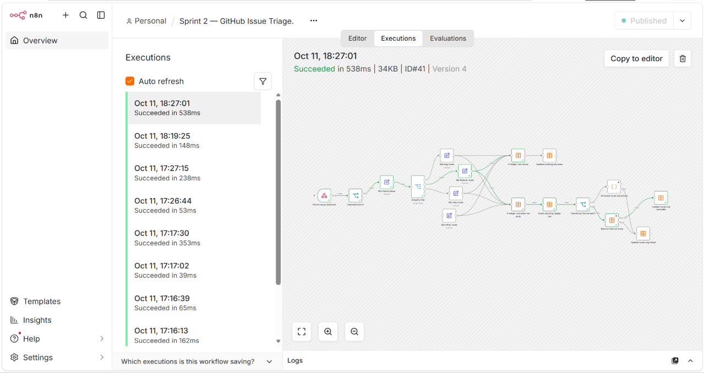
Figure 4. Execution #41 (18:27:01, Version 4): path through Set feature route, Insert pending ledger row, Record internal route, Update route-log recorded.

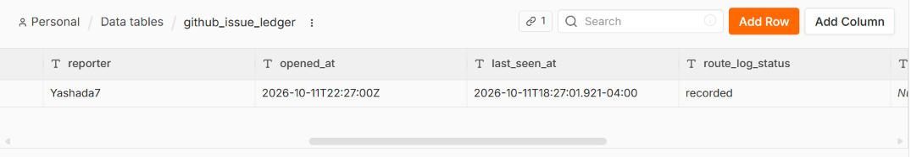
Figure 5. Ledger row for #7, recorded.

## Test 3: help (issue #8)

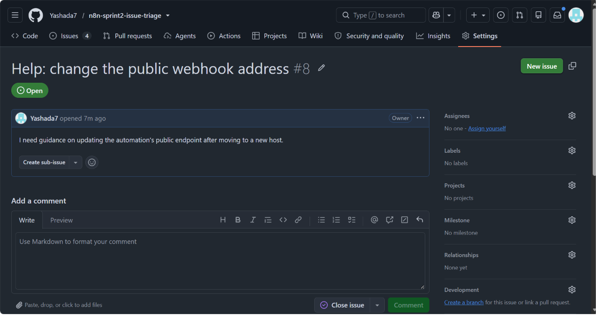
Figure 6. Issue #8.

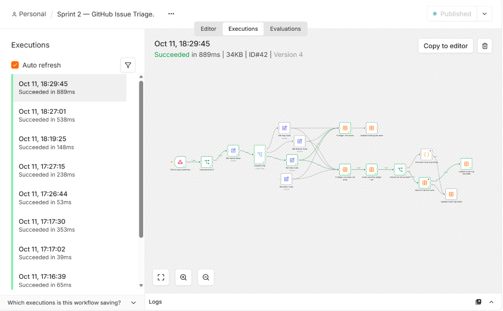
Figure 7. Execution #42 (18:29:45, Version 4): path through Set help route.

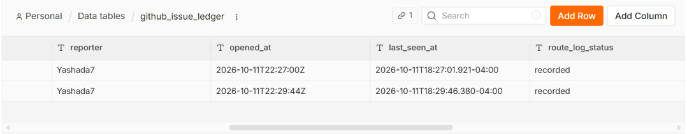
Figure 8. Ledger now has two rows (#7, #8), both recorded.

## Test 4: other (issue #10)

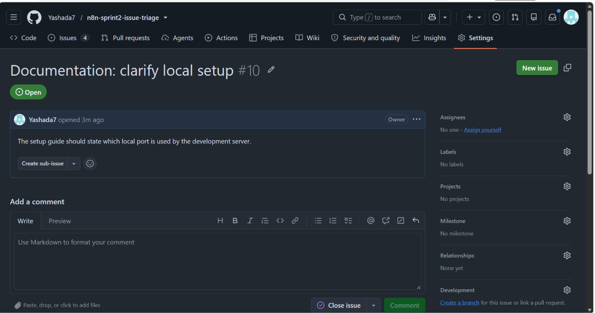
Figure 9. Issue #10.

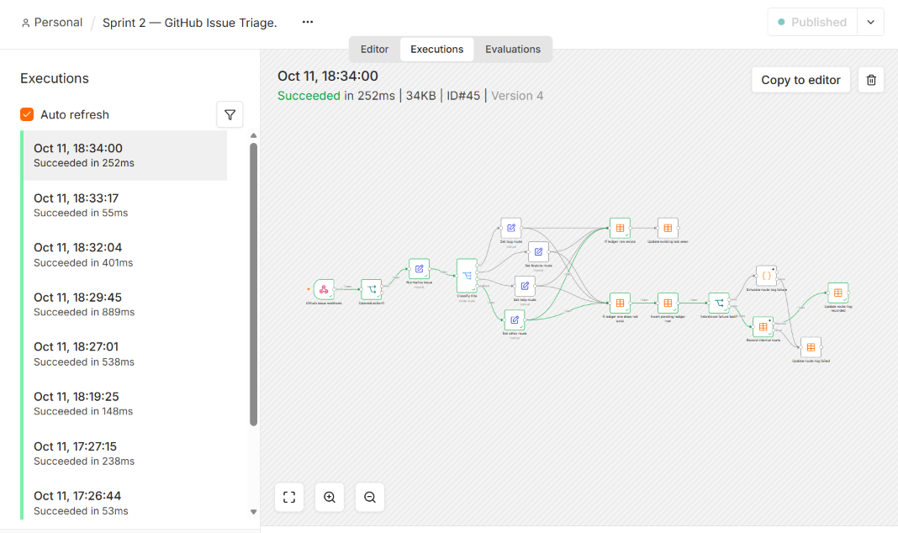
Figure 10. Execution #45 (18:34:00, Version 4): fallback output through Set other route.

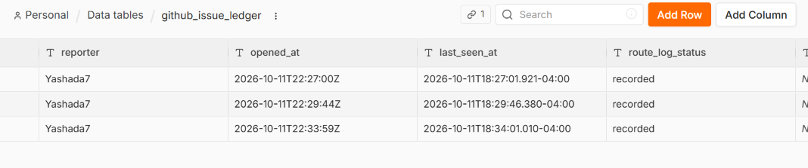
Figure 11. Ledger now has three rows, all recorded.

## Second bug-titled issue (#11) and route log

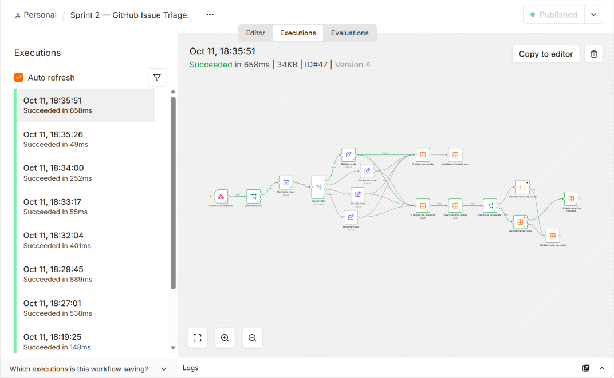
Figure 12. Execution #47 (18:35:51, Version 4) for #11: path through Set bug route, confirming the corrected bug regex.

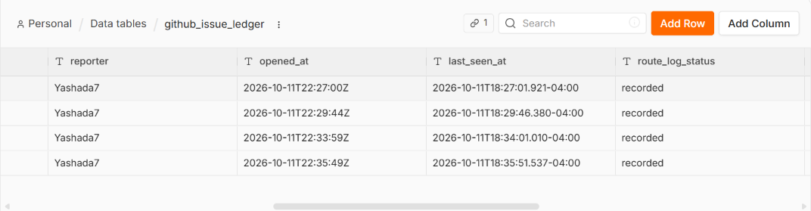
Figure 13. Ledger with four rows (#6, #7, #8, #10, plus #11 after this run).

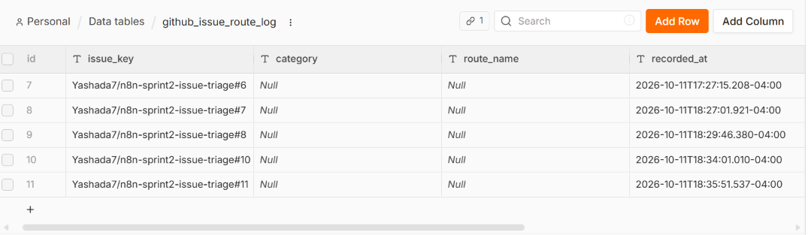
Figure 14. `github_issue_route_log` before the failure test: five rows, one per issue (#6, #7, #8, #10, #11); `recorded_at` filled, `category` and `route_name` Null.

## Deliberate route-log failure (issue #12)

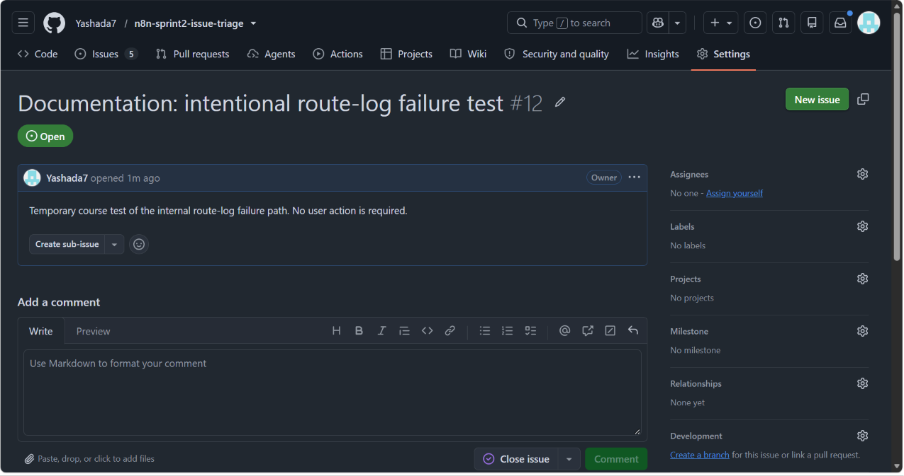
Figure 15. Issue #12 with the exact failure-test title and body.

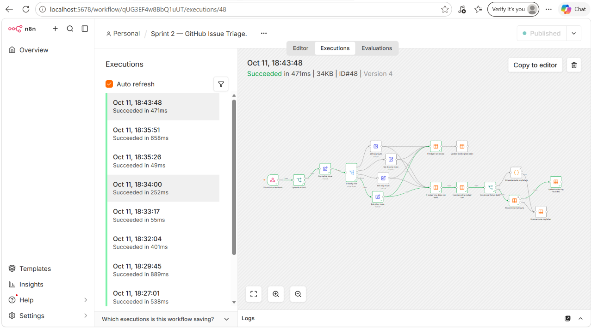
Figure 16. Execution #48 (18:43:48): went through Set other route and Record internal route to Update route-log recorded; it did not reach Simulate route-log failure.

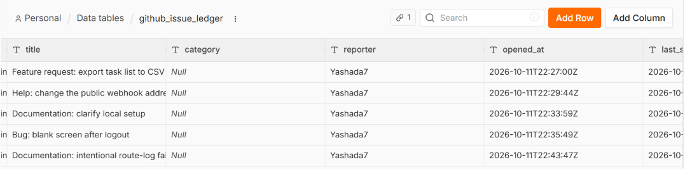
Figure 17. Ledger rows by title; `category` is Null for every row and the #12 row exists.

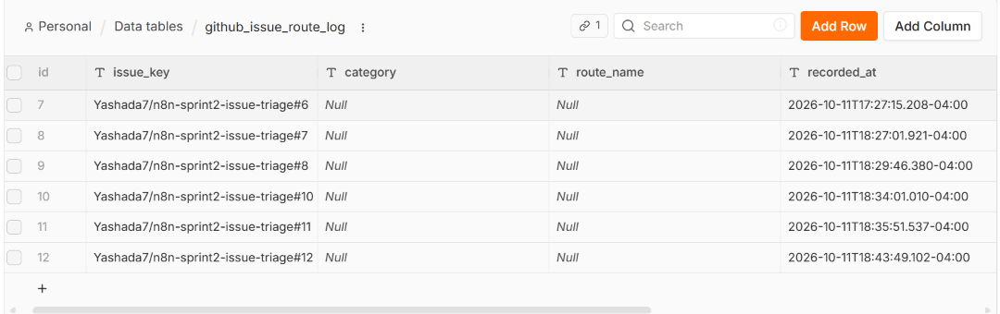
Figure 18. Route log after #12: a sixth row (id 12) exists. Expected: none.

## Known issues found during testing

| Issue | Evidence | Likely cause and fix |
| --- | --- | --- |
| Failure path never triggers | Figures 16, 18 | Intentional failure test? reads `{{ $json.title_lower }}` but follows Insert pending ledger row, whose output is the stored row with no `title_lower`. Use `{{ $('Normalize issue').item.json.title_lower }}`, republish, retest. |
| `category` and `route_name` stored as Null | Figures 14, 17, 18 | Check Set route node output: fields must be named `category` and `route_name`, fixed text, with Include Other Input Fields on; then check the Insert pending ledger row mapping. |
| Redelivery not demonstrated | First attempt returned HTTP 401 | Redeliver an `issues.opened` delivery created after the last forwarder restart; capture tables before and after. |
| Gate test not demonstrated | Only short execution entries | Append the course sentence to #10's body and screenshot the unchanged tables. |

Issue #11 reuses the Test 1 title as a separate issue with its own `issue_key`; it is not a redelivery of #6.
